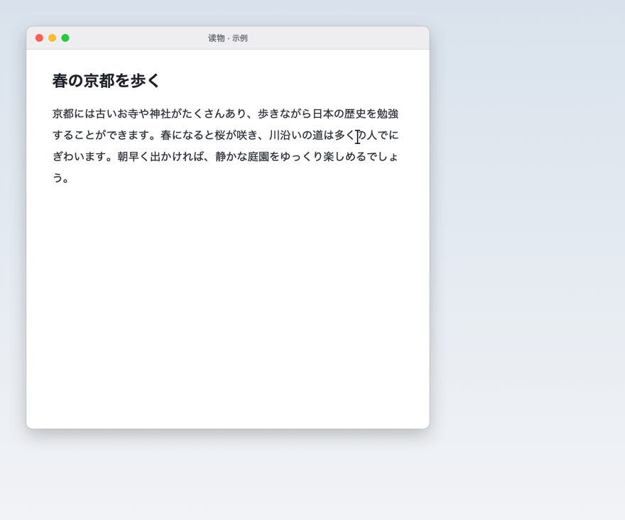
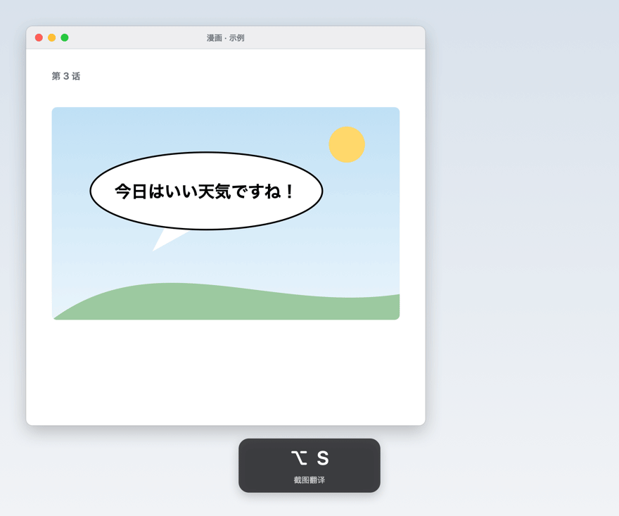
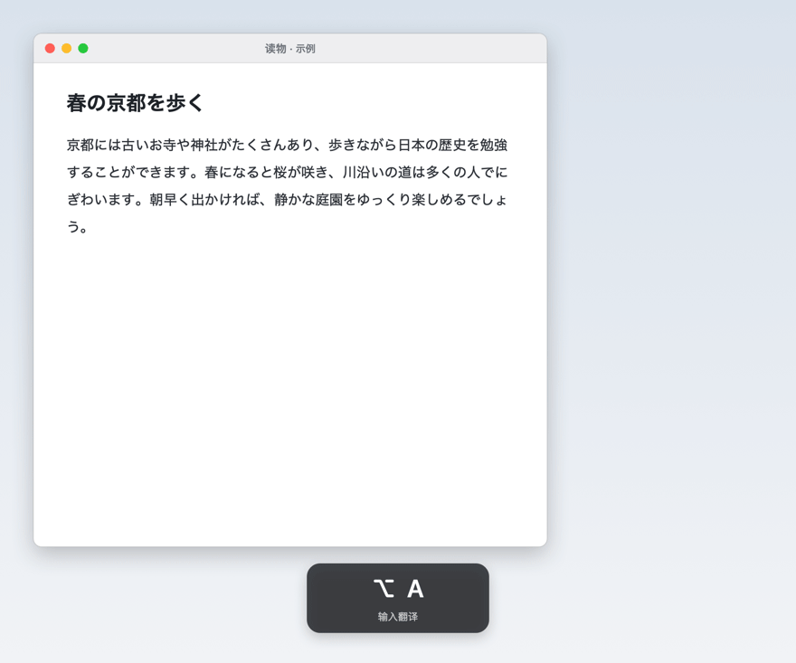
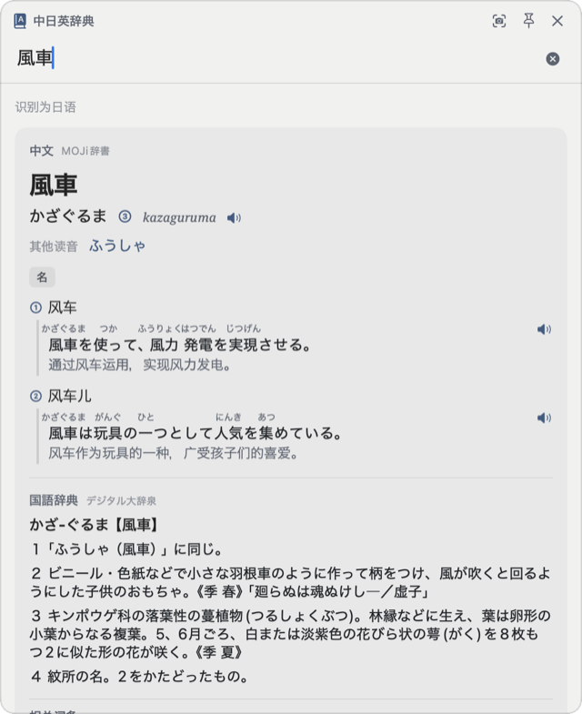
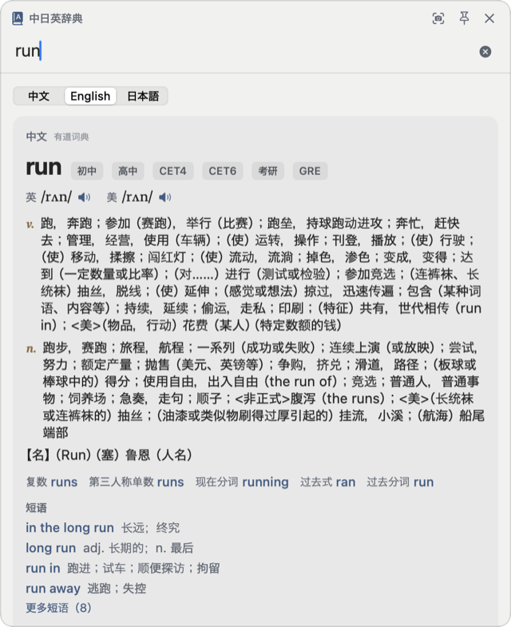
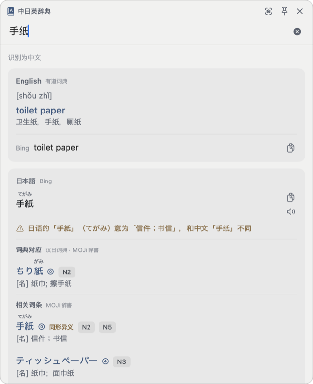
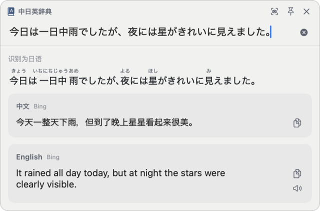

<h1 align="center">中日英辞典</h1>

<p align="center">
  专为中文用户打造的 macOS 日语、英语查词与翻译工具<br>
  划词、截图、输入，一个窗口同时呈现中、日、英三语结果
</p>

<p align="center">
  <a href="../../releases/latest"></a>
  
  
  
</p>

<p align="center">
  <a href="../../releases/latest"><b>下载最新版</b></a> · <a href="#安装">安装</a> · <a href="#快捷键">快捷键</a> · <a href="#常见问题">常见问题</a>
</p>

---

- **三语同屏**：输入任意一种语言，另外两种语言的结果一次呈现，无需来回切换
- **专业词典**：日语采用 MOJi 辞書与《デジタル大辞泉》，英语采用有道词典，释义、读音、例句一应俱全
- **同形异义提醒**：中日写法相同、意思不同的词（手纸 / 手紙、床、娘、走），自动提醒并给出正确说法
- **假名注音**：日文原文与译文自动标注假名，点击任意单词即可查询
- **轻量常驻**：菜单栏常驻，快捷键随时唤起，免费、无广告

## 划词翻译

在任意应用中选中文本，悬停于随即出现的图标上，即可在选区旁查看结果。查询内容可在窗口中直接修改，自动重新查询。

<p align="center"></p>

## 截图翻译

按 `⌥S` 框选屏幕区域，识别其中的文字并翻译，漫画、游戏、视频字幕、图片中无法选中的文字同样适用，竖排的日文（漫画对白、小说）也能按从右到左的顺序识别。文字识别在本机完成，日文结果自动标注假名。

<p align="center"></p>

## 输入翻译

按 `⌥A` 打开翻译窗口，中文、英文、日文直接输入，自动识别语言。

中文「手纸」是卫生纸，日语「手紙」却是信件。机器翻译遇到这类同形异义词常常照搬汉字，中日英辞典会明确提醒，并列出经词典确认的正确说法。

<p align="center"></p>

<sub>演示中的阅读窗口与漫画为示意内容，翻译窗口为应用实际界面。</sub>

## 查询结果

<table>
  <tr>
    <th align="center">日语单词</th>
    <th align="center">英语单词</th>
    <th align="center">中文单词</th>
    <th align="center">日语句子</th>
  </tr>
  <tr>
    <td><picture><source media="(prefers-color-scheme: dark)" srcset="docs/shot-ja-dark.png"></picture></td>
    <td><picture><source media="(prefers-color-scheme: dark)" srcset="docs/shot-en-dark.png"></picture></td>
    <td><picture><source media="(prefers-color-scheme: dark)" srcset="docs/shot-zh-dark.png"></picture></td>
    <td><picture><source media="(prefers-color-scheme: dark)" srcset="docs/shot-sentence-dark.png"></picture></td>
  </tr>
</table>

## 功能

**日语词典**
- 读音、声调、罗马音、词性、JLPT 等级
- 分义项中文释义，例句附假名注音与中文翻译
- 单词与例句均配有真人发音
- 收录《デジタル大辞泉》日文原版释义，可展开全部义项
- 自动还原活用形，查「食べさせられた」直接得到「食べる」，「静かだった」得到「静か」
- 同形异读词列出全部读音，一键切换，如「風車」かざぐるま／ふうしゃ、「生物」せいぶつ／なまもの

**英语词典**
- 英美音标与真人发音
- 四六级、考研、GRE 等考试标签
- 词形变化、常用短语、双语例句

**中文查日语、英语**
- 英文给出词典释义，点击英文单词可继续查询
- 日文给出机器翻译，以及经汉日词典确认的日语说法，均附读音与释义
- 识别中日同形异义词，提醒日语中的真正含义，避免照搬汉字造成误用

**句子翻译**
- 任一语言的句子同时译为另外两种语言，日文、英文原文可朗读
- 日文句子自动标注假名，点击句中单词即可查询其原形（点「行った」查询「行く」）
- 自动合并从 PDF、网页复制时产生的排版换行，整句翻译更准确
- 支持 Bing 翻译与 macOS 系统离线翻译，可设置失败时自动切换

**更多细节**
- 自动识别输入语言；「学习」「命令」等中日通用的汉字词可一键切换语言重新查询
- 释义中的词语可直接点击查询，支持返回
- 支持浅色与深色模式

## 安装

1. 从 [Releases](../../releases/latest) 下载 `DictTranslator-x.y.z.dmg`，双击打开后，将 `DictTranslator` 拖到「应用程序」文件夹。

2. 首次打开时，系统可能提示「已损坏，无法打开」或「无法验证开发者」。本应用未经 Apple 公证，文件本身并无问题，可通过以下任一方式打开：
   - 前往「系统设置 › 隐私与安全性」，在页面底部点击「仍要打开」；
   - 或在「终端」中执行：
     ```bash
     xattr -dr com.apple.quarantine /Applications/DictTranslator.app
     ```

3. 根据引导授予以下权限：

   | 权限 | 用途 |
   |---|---|
   | 辅助功能 | 读取其他应用中选中的文本（划词翻译、`⌥D`） |
   | 屏幕与系统音频录制 | 截图翻译（`⌥S`），授权后需重启应用 |

   未授予的权限只影响对应功能，输入翻译不受影响。

**更新**：下载新版本，拖到「应用程序」中替换原有应用即可，设置会保留。

**系统要求**：macOS 14 或更高版本，支持 Apple 芯片与 Intel 处理器。

## 快捷键

| 快捷键 | 功能 |
|---|---|
| `⌥A` | 输入翻译 |
| `⌥S` | 截图翻译 |
| `⌥D` | 翻译选中文本 |
| `Esc` | 关闭翻译窗口 |

快捷键可在「设置 › 通用」中自定义。

- 翻译窗口失去焦点时自动收起，点击右上角图钉可固定窗口。
- 划词时窗口显示在选区附近，通过快捷键打开时显示在屏幕右上角。
- 可在「设置 › 划词」中将应用加入黑名单，不显示划词图标。默认包含终端、Xcode、VS Code 与访达。
- 句子翻译默认使用 Bing。macOS 26 及以上可改用系统离线翻译，需先在「系统设置 › 通用 › 语言与地区 › 翻译语言」中下载中文、英语、日语。

## 常见问题

<details>
<summary>已在系统设置中授权，应用仍显示「未授权」</summary>

更新应用后，系统可能将其识别为新应用。请在「系统设置 › 隐私与安全性」的对应权限中移除「中日英辞典」，重新添加或勾选后重启应用。
</details>

<details>
<summary>选中文本后未出现划词图标</summary>

- 确认已授予「辅助功能」权限，且菜单栏菜单中已勾选「划词翻译」。
- 确认当前应用不在划词黑名单中（「设置 › 划词」）。
- 图标会在数秒后自动隐藏，可在设置中调整显示时长。
- 划词仅通过系统辅助功能读取选中文本，不会模拟 ⌘C，也不会改动剪贴板。少数不支持辅助功能的应用无法读取选区，此时选中文本后按 `⌥D` 即可翻译。
</details>

<details>
<summary>查询失败或句子无翻译结果</summary>

查询需要网络连接。可点击结果中的「重试」，或在输入框中按回车重新查询。也可在「设置 › 通用」中开启「失败时自动换用另一个服务」，或改用系统离线翻译。
</details>

<details>
<summary>汉字词被识别成了另一种语言</summary>

「学习」「命令」「床」等中日通用的汉字词可能被识别为另一种语言，点击结果上方「识别为中文 · 改为日语」中的「改为…」即可切换。含有只属于一种语言的字（如「们」「経」）或含假名的文本不会识别错误，不显示切换。
</details>

<details>
<summary>隐私与数据</summary>

截图仅在本机完成文字识别，识别后立即删除，不会上传。识别出的文字以及选中、输入的文字会发送至下方列出的词典与翻译服务进行查询。应用不包含任何统计或追踪。
</details>

## 数据来源与声明

本应用为免费的个人学习工具，内容来自以下服务：

| 内容 | 来源 |
|---|---|
| 日语词典、真人发音 | MOJi 辞書 |
| 日文释义 | 《デジタル大辞泉》（小学館），经由 Weblio 辞書 |
| 英语词典、英语发音、汉日对应词 | 有道词典 |
| 句子翻译 | Bing 翻译、macOS 系统翻译（可在设置中选择） |
| 文字识别、句子朗读、假名注音 | macOS 系统功能、MeCab（本机运行） |

上述在线服务均通过其网页版接口访问，并非官方开放 API，可能随时变更或不可用。请仅用于个人学习，并遵守各服务的使用条款。

问题反馈与功能建议请提交至 [Issues](../../issues)。

<details>
<summary><b>开发</b></summary>

### 从源码构建

需要 Xcode（Swift 5.10+）。

```bash
git clone https://github.com/FinnKyo/mac-trilingual-dict.git
cd mac-trilingual-dict
./build.sh            # 编译通用二进制、签名并安装到 /Applications
```

`build.sh` 优先使用钥匙串中的 Apple Development / Developer ID 证书签名，重新编译后系统权限不会失效；无证书时使用临时签名，每次重新编译后需重新授权辅助功能。仅编译不安装：`NO_INSTALL=1 ./build.sh`。

### 常用命令

```bash
swift test                                                       # 解析、语言识别与网络接口测试
.build/debug/DictTranslator --render "食べた" out.png [--dark]     # 离屏渲染查询结果
.build/debug/DictTranslator --dump "推し" "汽车" "静かだった"     # 以文字输出各项查询结果与耗时，批量检查用
.build/debug/DictTranslator --furigana "今日は一日中雨"            # 查看注音与原形
.build/debug/DictTranslator --identify corpus.json               # 中日识别准确率（{"ja": [...], "zh": [...]}）
.build/debug/DictTranslator --word-bench words.json out.json     # 中文单词 → 日语评测，词表见 scripts/bench
.build/debug/DictTranslator --mt-bench src.txt zh ja out.txt 100 # 逐行翻译，再用 scripts/chrf.py 打分
scripts/package.sh                                               # 生成发布用 DMG
scripts/demo/make_demo.sh                                        # 重新生成 docs/ 中的演示图（需要 ffmpeg）
```

演示图仅截取调试版应用自身的窗口（不需要屏幕录制权限，也不会包含桌面内容），再合成到 `scripts/demo/scene.swift` 绘制的示意场景中。

### 实现说明

| 模块 | 实现 |
|---|---|
| 日语词条、发音 | MOJi 辞書网页接口（搜索 REST 接口，词条与发音 Parse 云函数） |
| 日文释义 | Weblio 页面中的《デジタル大辞泉》条目 |
| 英语、汉英词条 | 有道词典网页接口 |
| 中文词 → 日语 | 有道《现代日汉汉日词典》对应词，经 MOJi 校验写法；按 MOJi 释义识别同形异义（`FalseFriendDetector`） |
| 句子翻译 | Bing 翻译网页接口或 macOS Translation 框架，翻译前合并排版换行 |
| 中日语言识别 | 汉字字库归属（GB2312 / JIS）、NaturalLanguage、词典收录、Google 语言检测加权判断 |
| 日文注音、原形 | MOJi 例句注音；其余使用 MeCab + IPADic 离线分析，数词＋量词按音变规则重新注音 |
| 文字识别 | VisionKit 实况文本（支持竖排、按段落合并折行），不可用时退回 Vision |
| 朗读 | AVSpeechSynthesizer |

```
Sources/DictTranslator/
  App/         菜单栏、快捷键、权限、设置项、调试命令
  Core/        语言识别、同形异义检查、查询状态（LookupViewModel）
  Services/    各词典与翻译服务、注音、OCR、发音
  Selection/   划词监听与选中文本读取
  Screenshot/  截图翻译
  UI/          翻译窗口、结果与词条视图、设置界面
scripts/       打包、演示图生成、评测
```

第三方依赖：[KeyboardShortcuts](https://github.com/sindresorhus/KeyboardShortcuts)（MIT）、[Mecab-Swift](https://github.com/shinjukunian/Mecab-Swift)（MIT，内含 [MeCab](https://taku910.github.io/mecab/)（BSD）与 IPADic 词典（NAIST/IPA 许可））。
</details>

## 许可证

[GPL-3.0](LICENSE)
