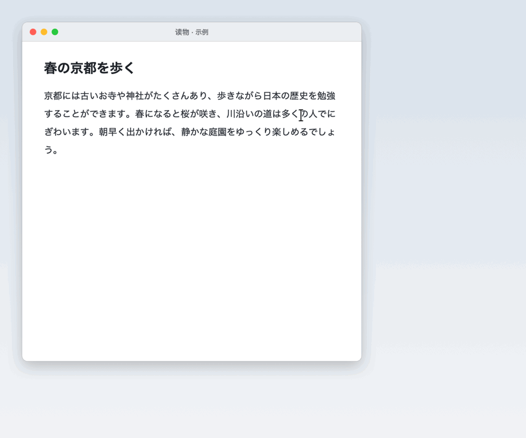
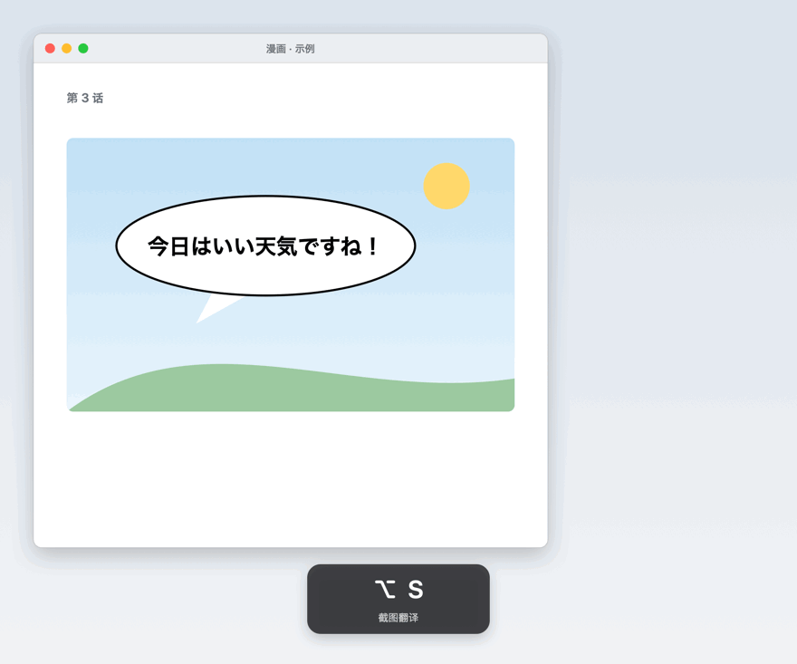
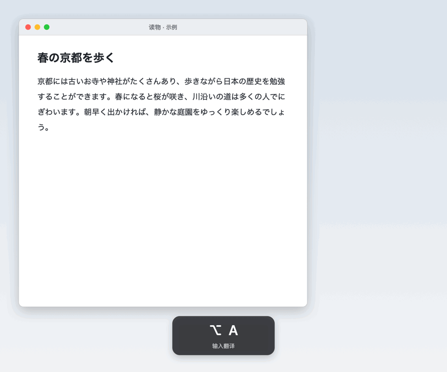
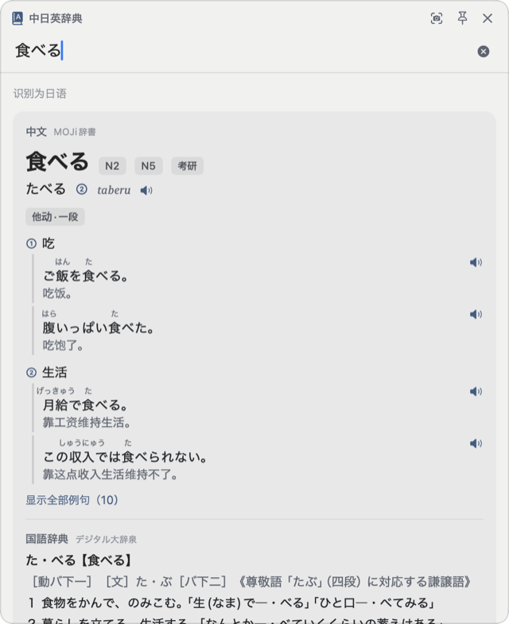
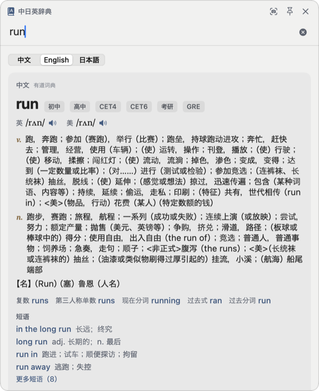
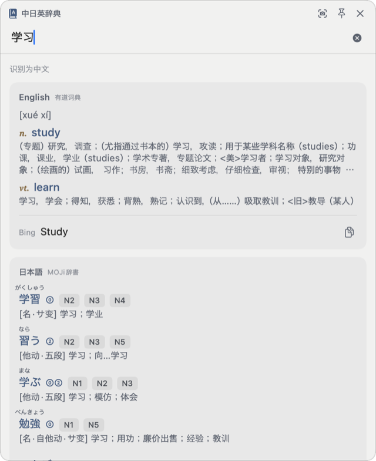
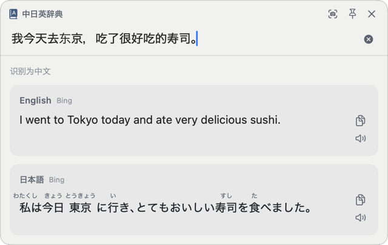

<h1 align="center">中日英辞典</h1>

<p align="center">
  面向中文用户的 macOS 日语、英语查词与翻译工具<br>
  支持划词翻译、截图翻译与输入翻译，同时呈现中、日、英三语结果
</p>

<p align="center">
  <a href="../../releases/latest"></a>
  
  
  <a href="LICENSE"></a>
</p>

<p align="center">
  <a href="../../releases/latest">下载</a> · <a href="#安装">安装</a> · <a href="#快捷键">快捷键</a> · <a href="#常见问题">常见问题</a>
</p>

## 划词翻译

选中任意应用中的文本，悬停于随即出现的图标上，即可在选区旁查看释义。查询内容可在窗口中直接修改。

<p align="center"></p>

## 截图翻译

按 `⌥S` 框选屏幕区域，识别其中的文字并翻译，适用于漫画、游戏、视频字幕等无法选中的文本。日文结果附假名注音。

<p align="center"></p>

## 输入翻译

按 `⌥A` 打开翻译窗口，支持输入中文、英文、日文。

<p align="center"></p>

<sub>演示中的阅读窗口与图片为示意内容，翻译窗口为应用实际界面。</sub>

## 查询结果

<table>
  <tr>
    <th align="center">日语单词</th>
    <th align="center">英语单词</th>
    <th align="center">中文单词</th>
    <th align="center">句子</th>
  </tr>
  <tr>
    <td><picture><source media="(prefers-color-scheme: dark)" srcset="docs/shot-ja-dark.png"></picture></td>
    <td><picture><source media="(prefers-color-scheme: dark)" srcset="docs/shot-en-dark.png"></picture></td>
    <td><picture><source media="(prefers-color-scheme: dark)" srcset="docs/shot-zh-dark.png"></picture></td>
    <td><picture><source media="(prefers-color-scheme: dark)" srcset="docs/shot-sentence-dark.png"></picture></td>
  </tr>
</table>

## 功能

**三语互译**
- 输入任一语言，同时显示另外两种语言的结果
- 单词显示词典释义，句子显示机器翻译
- 句子翻译可选 Bing 翻译或 macOS 系统离线翻译，长文本自动分段翻译并保留原有分段

**日语词典**
- 读音、声调、罗马音、词性、JLPT 等级
- 分义项的中文释义，例句附假名注音与中文翻译
- 单词与例句均提供真人发音
- 日文释义来自《デジタル大辞泉》，可展开全部义项
- 自动还原活用形，如「食べさせられた」→「食べる」
- 同音词与相关词条

**英语词典**
- 英美音标与发音
- 考试标签（CET-4 / CET-6 / 考研 / GRE 等）
- 词形变化、常用短语、双语例句

**其他**
- 日文原文与译文自动标注假名
- 自动识别输入语言；「命令」「学习」这类中日都能成立的汉字词，可一键改按另一种语言查询
- 释义中的词语可直接查询，支持返回
- 常驻菜单栏，支持浅色与深色模式

## 安装

1. 从 [Releases](../../releases/latest) 下载 `DictTranslator-x.y.z.zip`，解压后将 `DictTranslator.app` 移至「应用程序」文件夹。
2. 首次打开时，系统可能提示「已损坏，无法打开」或「无法验证开发者」。本应用未经 Apple 公证，文件本身并无问题，可通过以下任一方式打开：
   - 前往「系统设置 › 隐私与安全性」，在页面底部点击「仍要打开」；
   - 或在「终端」中执行：
     ```bash
     xattr -dr com.apple.quarantine /Applications/DictTranslator.app
     ```
3. 根据引导授予以下权限：

   | 权限 | 用途 |
   |---|---|
   | 辅助功能 | 读取其他应用中选中的文本（划词翻译、`⌥D`） |
   | 屏幕与系统音频录制 | 截取所选区域并识别文字（`⌥S`），授权后需重启应用 |

截图仅在本机完成文字识别，图片在识别后立即删除，不会上传。识别出的文字及划词选中的文字将发送至词典与翻译服务进行查询。

更新时，下载新版本并覆盖原有应用即可。

**系统要求**：macOS 14 或更高版本，支持 Apple 芯片与 Intel 处理器。

## 快捷键

| 快捷键 | 功能 |
|---|---|
| `⌥A` | 输入翻译 |
| `⌥S` | 截图翻译 |
| `⌥D` | 翻译选中文本 |
| `Esc` | 关闭翻译窗口 |

快捷键可在「设置 › 通用」中自定义。

- 翻译窗口失去焦点时自动关闭，点击右上角图钉可将其固定。
- 划词翻译时窗口显示在选区附近，通过快捷键打开时显示在屏幕右上角。
- 可在「设置 › 划词」中将指定应用加入黑名单，不显示划词图标。

## 常见问题

<details>
<summary>已在系统设置中授权，应用仍显示「未授权」</summary>

更新应用后，系统可能将其识别为新的应用。请在「系统设置 › 隐私与安全性」的对应权限中移除「中日英辞典」，重新添加或勾选后重启应用。
</details>

<details>
<summary>选中文本后未出现划词图标</summary>

- 确认已授予「辅助功能」权限，且菜单栏菜单中已勾选「划词翻译」。
- 确认当前应用不在划词黑名单中（「设置 › 划词」）。默认黑名单包括终端、Xcode、VS Code 和访达。
- 图标会在数秒后自动隐藏，可在设置中调整显示时长。
- 也可在选中文本后按 `⌥D` 直接翻译。
</details>

<details>
<summary>查询失败或句子无翻译结果</summary>

查询需要网络连接。可点击结果中的「重试」，或在输入框中按回车重新查询。句子翻译默认使用 Bing，可在「设置 › 通用」中改用系统离线翻译，或开启「失败时自动换用另一个服务」。系统离线翻译需 macOS 26 或更高版本，并在「系统设置 › 通用 › 语言与地区 › 翻译语言」中下载中文、英语、日语。
</details>

<details>
<summary>汉字词被识别成了另一种语言</summary>

「命令」「学习」这类在中文、日语里都成立的汉字词，可能被识别为另一种语言。点击结果上方「识别为中文 · 改为日语」中的「改为…」即可切换。含有只属于一种语言的字（如「们」「経」）或含假名的文本不会识别错，不显示切换。
</details>

## 数据来源与声明

本应用为免费的个人学习工具，内容来自以下服务：

| 内容 | 来源 |
|---|---|
| 日语词典、真人发音 | MOJi 辞書 |
| 日文释义 | 《デジタル大辞泉》（小学館），经由 Weblio 辞書 |
| 英语词典、英语发音 | 有道词典 |
| 句子翻译 | Bing 翻译、macOS 系统翻译（可在设置中选择） |
| 文字识别、句子朗读 | macOS 系统功能 |

上述在线服务均通过其网页版接口访问，并非官方开放 API，可能随时变更或不可用。请仅用于个人学习，并遵守各服务的使用条款。

<details>
<summary><b>开发</b></summary>

### 从源码构建

需要 Xcode（Swift 5.10+）。

```bash
git clone https://github.com/FinnKyo/mac-trilingual-dict.git
cd mac-trilingual-dict
./build.sh            # 编译通用二进制、签名并安装到 /Applications
```

`build.sh` 优先使用钥匙串中的 Apple Development / Developer ID 证书签名，重新编译后系统权限不会失效；无证书时使用临时签名，每次重新编译后需重新授权辅助功能。仅编译不安装：`NO_INSTALL=1 ./build.sh`。

### 常用命令

```bash
swift test                                              # 解析、语言识别与网络接口测试
swift build && .build/debug/DictTranslator --render "食べた" out.png [--dark]   # 离屏渲染结果界面
.build/debug/DictTranslator --identify corpus.json      # 中日识别准确率评测（{"ja": [...], "zh": [...]}）
scripts/package.sh                                      # 生成发布用 zip
scripts/demo/make_demo.sh                               # 重新生成 docs/ 中的演示动画与截图
```

`docs/` 中的演示图由 `scripts/demo/make_demo.sh` 生成：仅截取调试版应用自身的窗口，不需要屏幕录制权限，也不会包含桌面内容，再合成到 `scene.swift` 绘制的示意场景中。

### 实现说明

| 模块 | 实现 |
|---|---|
| 日语词条、汉日反查、日语发音 | MOJi 辞書网页接口（搜索 REST 接口，词条与发音 Parse 云函数） |
| 日文释义 | Weblio 辞書页面中的《デジタル大辞泉》条目 |
| 英语词条、汉英词条、英语单词发音 | 有道词典网页接口 |
| 句子翻译 | Bing 翻译网页接口或 macOS 系统离线翻译（Translation 框架），可在「设置 › 通用」中选择，失败时可自动换用另一个 |
| 句子朗读 | AVSpeechSynthesizer |
| 中日语言识别 | 汉字字库归属（GB2312 / JIS）、NaturalLanguage、词典收录、Google 语言检测加权判断 |
| 日文注音 | MOJi 例句注音；其余使用 CFStringTokenizer |
| 文字识别 | Vision |

### 目录结构

```
Sources/DictTranslator/
  App/         菜单栏、主菜单、快捷键、权限、设置项
  Core/        语言识别、词句判定、查询状态（LookupViewModel）
  Services/    MOJi 辞書、Weblio、有道词典、翻译服务、注音、OCR、发音
  Selection/   划词监听、选中文本读取、划词图标
  Screenshot/  截图翻译
  UI/          翻译窗口、结果视图、词条视图、配色、设置界面
scripts/       打包与演示图生成
```

第三方依赖：[KeyboardShortcuts](https://github.com/sindresorhus/KeyboardShortcuts)（MIT）。
</details>

## 许可证

[GPL-3.0](LICENSE)
